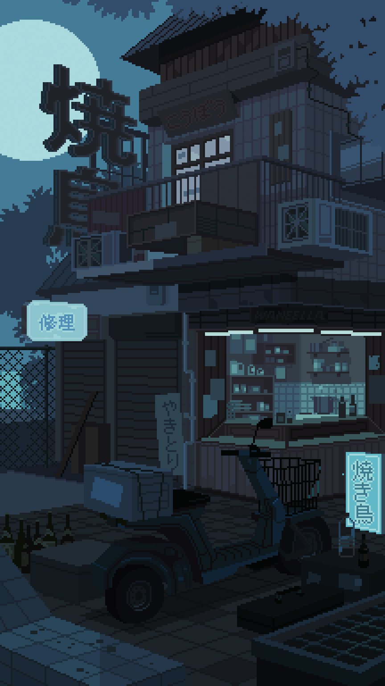
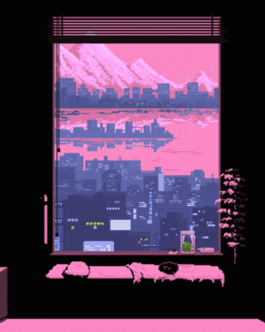
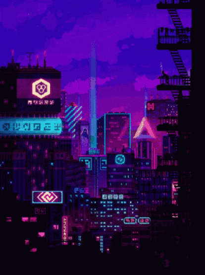

# 🌌 Cyberdeck / Violet Startpage

<p align="center">
  
</p>

<p align="center">
  <b>Une page d'accueil (startpage) modulaire, moderne et immersive conçue pour booster votre productivité tout en sublimant votre navigateur.</b>
</p>

<p align="center">
  
  
  
  
  
</p>

---

## 📸 Aperçu des Thèmes

La page intègre **3 thèmes visuels complets** avec éclairage ambiant (Ambilight), orbes lumineux animés et scanlines rétro. Vous pouvez basculer d'un thème à l'autre en un clic ou via le pavé numérique (<kbd>1</kbd>, <kbd>2</kbd>, <kbd>3</kbd>).

| Thème 1 : Kanagawa 🌊 | Thème 2 : Sakura 🌸 | Thème 3 : Cyberdeck ⚡ |
| :---: | :---: | :---: |
|  |  |  |
| *Palette Cyan & Menthe froide* | *Palette Rose & Néo-Pastel* | *Palette Cyberpunk Violet & Néon* |

---

## ✨ Fonctionnalités Clés

### 🔍 1. Barre de Recherche Intelligente (Omnibox) — `js/search.js`
- **Raccourci instantané** : Appuyez sur la touche <kbd>/</kbd> n'importe où pour cibler immédiatement la recherche.
- **Moteurs de recherche & Préfixes rapides (Bangs)** :
  Tapez un préfixe pour changer instantanément de moteur de recherche :
  - `!yt <requête>` : Rechercher sur **YouTube**
  - `!gh <requête>` : Rechercher sur **GitHub**
  - `!tr <texte>` : Traduire avec **DeepL**
  - `!maps <lieu>` : Localiser sur **Google Maps**
  - `!img <terme>` : Rechercher sur **Google Images**
  - `!w <terme>` : Rechercher sur **Wikipédia**
  - `!d <requête>` : Rechercher sur **DuckDuckGo**
  - `!so <requête>` : Rechercher sur **StackOverflow**
  - `!arch <sujet>` : Consulter le wiki **ArchLinux**
  - `!r <terme>` : Rechercher sur **Reddit**
  - `!help` : Afficher l'aide interactive des commandes
- **Calculatrice en direct** : Saisissez une expression mathématique (ex: `15 * 4`, `(120/4) + 8`) et le résultat s'affiche en temps réel sans recharger la page.
- **Suggestions automatiques** : Autocomplétion Google en temps réel navigable au clavier (flèches <kbd>↑</kbd> <kbd>↓</kbd>).

### ⚡ 2. Signets & Mode Personnalisation Complet — `js/bookmarks.js`
- **4 catégories organisées** : *Social*, *Jeux*, *IA* (Gemini, ChatGPT, Claude, DeepSeek...) et *Unif / Travail*.
- **Mode Personnalisation interactif** : Cliquez sur <kbd>Personnaliser</kbd> pour afficher la barre d'outils dédiée.
- **Réorganisation par Glisser-Déposer (Drag & Drop)** : Réordonnez vos favoris ou déplacez-les d'une catégorie à l'autre en un simple glissé.
- **Sauvegarde & Restauration (Export / Import JSON)** : Téléchargez un fichier de configuration `.json` ou restaurez-le en 1 clic pour retrouver l'intégralité de vos signets, tâches, flux et réglages sur n'importe quel appareil.
- **Modale de personnalisation** : Modification du titre, de l'URL et sélection d'icônes Font Awesome avec aperçu en temps réel.
- **Persistance locale** : Toutes vos modifications sont enregistrées dans le `localStorage` de votre navigateur.

### 📅 3. Mini-Calendrier & Filtre d'échéances — `js/calendar.js`
- Vue calendaire complète du mois en cours avec mise en évidence du jour actuel.
- Navigation d'un mois à l'autre et bouton retour rapide à aujourd'hui (<kbd>auj</kbd>).
- **Filtre synchronisé** : Cliquez sur une date du calendrier pour afficher uniquement les tâches associées à ce jour.

### ✅ 4. Gestionnaire de Tâches (Tasks / To-Do List) — `js/tasks.js`
- Ajout de tâches avec date d'échéance optionnelle.
- Badges d'urgence dynamiques : `Auj.`, `J-X` (à venir) et `J+X` (en retard).
- Validation d'un clic pour rayer une tâche terminée, suppression rapide.
- Synchronisation complète avec le calendrier et persistance `localStorage`.

### 🌤️ 5. Météo Détaillée & Effets d'Arrière-Plan Dynamiques — `js/weather.js` & `js/weather-fx.js`
- **Widget Météo en direct & Modale complète** : Cliquez sur la pilule météo pour ouvrir les détails météo (température ressentie, humidité, vitesse du vent, indice UV) et les **prévisions complètes sur 3 jours**.
- **Sélection manuelle de la ville** : Entrez votre ville dans la modale ou revenez en un clic à la détection automatique par IP.
- **Effets météo d'arrière-plan sur Canvas** : Particules animées réagissant à la météo réelle (pluie et reflets, flocons de neige, éclairs d'orage, brume flottante ou étoiles néon scintillantes).
- **Contrôle manuel ON/OFF** : Bouton dans la topbar et interrupteur dans la modale pour activer/désactiver les effets à tout moment.

### 📰 6. Flux d'Actualités Personnalisables — `js/feeds.js`
- Onglets d'actualités intégrés avec skeleton loading (F1, Football, Tech).
- **Gestionnaire de flux RSS sur mesure** : Ajoutez vos propres flux RSS (blogs, actualités spécialisées, Reddit...) depuis le menu de personnalisation pour les consulter directement dans le widget.

---

## 🏗️ Architecture Propre & Modulaire

Le projet a été restructuré pour séparer distinctement la structure HTML, les feuilles de style de chaque thème et chaque module JavaScript fonctionnel :

```text
violet-startpage/
├── index.html                  # Structure HTML épurée & chargement modulaire
├── README.md                   # Documentation complète du projet
├── .gitignore                  # Fichiers et dossiers exclus de Git
│
├── css/                        # Feuilles de styles modulaires
│   ├── style.css               # Styles de base, Bento Grid, composants & responsive
│   └── themes/                 # Thèmes visuels autonomes
│       ├── kanagawa.css        # Thème 1 : Kanagawa (Cyan / Menthe froide)
│       ├── sakura.css          # Thème 2 : Sakura (Rose / Néo-pastel)
│       └── cyberdeck.css       # Thème 3 : Cyberdeck (Néon violet & cyan)
│
├── js/                         # Logique JavaScript modulaire
│   ├── app.js                  # Point d'entrée & bootstrapping DOMContentLoaded
│   ├── themes.js               # Gestionnaire de thèmes et éclairage Ambilight
│   ├── weather-fx.js           # Effets météo d'arrière-plan dynamiques sur Canvas
│   ├── bookmarks.js            # Signets personnalisables, Drag & Drop & Export/Import JSON
│   ├── search.js               # Omnibox : moteur, calculatrice, bangs & autocomplétion
│   ├── calendar.js             # Mini-calendrier mensuel interactif
│   ├── tasks.js                # To-Do list, calcul des échéances & filtrage
│   ├── clock.js                # Horloge numérique et calendrier français
│   ├── weather.js              # Widget météo, géolocalisation & modale détaillée
│   ├── feeds.js                # Flux d'actualités en direct & flux RSS personnalisés
│   └── shortcuts.js            # Raccourcis clavier globaux
│
└── images/                     # Médias et animations des thèmes
    ├── gif.gif                 # Artwork Thème 1 (Kanagawa)
    ├── gif2.gif                # Artwork Thème 2 (Sakura)
    ├── gif3.gif                # Artwork Thème 3 (Cyberdeck)
    └── gif_origin.gif
```

---

## ⌨️ Raccourcis Clavier

| Raccourci | Action |
| :--- | :--- |
| <kbd>/</kbd> | Activer immédiatement la barre de recherche |
| <kbd>1</kbd>, <kbd>2</kbd>, <kbd>3</kbd> | Basculer entre les thèmes (Kanagawa / Sakura / Cyberdeck) |
| <kbd>Échap</kbd> | Fermer la modale d'édition ou masquer les suggestions |
| <kbd>Entrée</kbd> | Valider une recherche, ajouter une tâche ou enregistrer |
| <kbd>↑</kbd> / <kbd>↓</kbd> | Naviguer dans les suggestions de recherche |

---

## 🚀 Installation & Utilisation

### Option A : Utilisation locale (Recommandée)
1. Clonez ce dépôt ou téléchargez l'archive :
   ```bash
   git clone https://github.com/ugovds/startup_page.git
   ```
2. Ouvrez simplement `index.html` dans votre navigateur Web (Chrome, Firefox, Brave, Edge...).
3. Pour définir comme nouvel onglet :
   - Utilisez une extension telle que **New Tab Override** ou **Custom New Tab URL**.
   - Indiquez le chemin vers votre fichier : `file:///chemin/vers/index.html`.

### Option B : Déploiement en ligne gratuit (GitHub Pages)
1. Rendez-vous sur votre dépôt GitHub : [https://github.com/ugovds/startup_page](https://github.com/ugovds/startup_page).
2. Rendez-vous dans **Settings** > **Pages**.
3. Sous **Branch**, sélectionnez `main` et `/ (root)`, puis cliquez sur **Save**.
4. Votre startpage sera instantanément accessible en ligne à l'adresse :
   ```text
   https://ugovds.github.io/startup_page/
   ```

---

## 🎨 Créer un Nouveau Thème

Grâce à la nouvelle architecture modulaire, ajouter un thème est un jeu d'enfant :
1. Créez un fichier `css/themes/mon-theme.css` avec vos variables CSS :
   ```css
   body[data-theme="4"] {
     --bg-deep: #0a0e14;
     --accent-primary: #ffaa00;
     --accent-secondary: #00e5ff;
     /* ... */
   }
   ```
2. Liez-le dans `index.html` ou importez-le dans `css/style.css`.
3. Déclarez l'artwork et le nom du thème dans `js/themes.js`.
